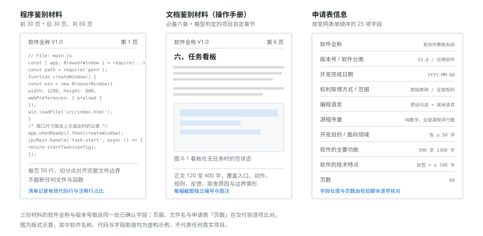
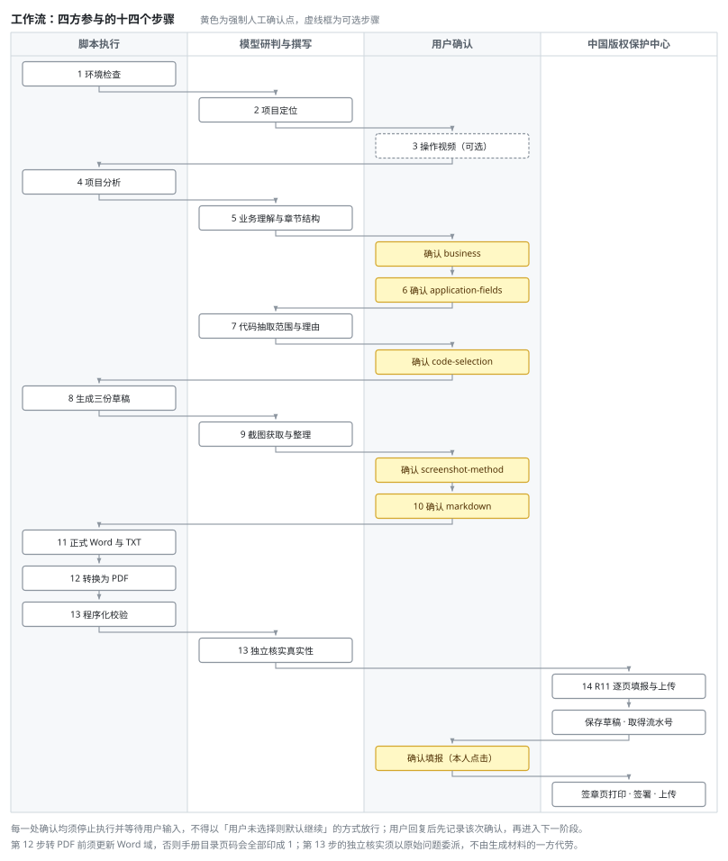

# software-copyright-materials

[](LICENSE)
[](#运行依赖)
[](SKILL.md)

从真实软件项目生成中国计算机软件著作权登记材料，并辅助在中国版权保护中心完成填报与签章。

材料由模型阅读项目后撰写，脚本只负责排版、校验与归档；流程中设有七处强制人工确认，缺少必要输入时停止，而非按模板缺省生成。

> **适用**：计算机软件著作权（R11）的鉴别材料、申请表信息与官网填报。
> **不适用**：专利、商标，以及非软件类作品的著作权登记。

## 快速开始

**一、安装**——克隆到运行环境的 skill 目录，具体位置按该环境的 Skill 发现规则确定：

```bash
git clone https://github.com/suling-fun/software-copyright-materials-skill.git \
  <运行环境的 skill 目录>/software-copyright-materials
```

**二、触发**——在待登记的项目目录下，向助手说明：

```
用 software-copyright-materials 为当前项目生成软件著作权申请资料
```

提及「软著」「软著材料」「代码鉴别材料」「操作手册」「官网填报」一类词亦可触发。

**三、应答**——流程在七处停止并等待输入：项目定位、业务口径、申请表字段、代码抽取范围、截图方式、草稿确认，以及 DOCX 环境缺失时的降级选择（该项仅在环境不全时出现）。逐项答复即可，其余由流程自行推进。向平台点击「确认填报」不在其列，须由申请人本人执行。此外，材料生成完毕并通过验证后另有一次分叉询问：是否继续提交至版权中心。该询问不写入确认记录，只决定流程是否进入平台填报阶段；其前的 DOCX 生成与 PDF 转换一律自动执行。

**四、产出**——全部材料生成于待登记项目的根目录下：

```
<项目根目录>/软件著作权申请资料/
├── 正式资料/            # 可提交：申请表 TXT、代码与手册的 DOCX 及 PDF
├── 草稿/                # 业务理解、代码选择、申请表、操作手册与自检记录
├── 截图/                # 操作手册插图
├── 用户截图/            # 用户提供的原始截图，整理后进入上一目录
├── 操作视频/            # 视频帧，仅在提供录屏时生成
├── 提交记录/            # 流水号、平台状态、签章页与回执
├── analysis/            # 项目分析的中间产物
├── 环境检查.md          # 与同名 .json，运行能力检查结果
├── 截图方式确认.json     # 截图方式的确认记录
└── 校验报告.md          # 交付前的程序化校验结果
```

正式资料与提交记录分开存放：前者是可提交的材料本身，后者是某一次申请的过程凭据（流水号、签章页、回执），不随材料复用。

## 交付物

一次完整运行产出三份可提交材料。



| 材料 | 内容与约束 |
| --- | --- |
| 程序鉴别材料 | 源程序前 30 页与后 30 页合并为一份文档，页码连续。每页 50 行，切分点对齐完整文件边界，不截断任何文件与函数；抽取时自动重排文件顺序使前后段各满 30 页，确实无法对齐时偏差超阈值即停止，阈值内则以真实页数命名文件。另统计有效代码行与注释行占比 |
| 文档鉴别材料 | 操作手册。必备六章固定，项目自定章节由模型按三条判定标准决定是否设立；正文由模型撰写，每幅截图带独立编号与图注 |
| 申请表信息 | 按官网表单顺序的 25 项字段，长度限制与页数由校验脚本逐项核对 |

三份材料的软件全称与版本号取自同一处已确认字段，页眉、文件名与申请表「页数」在交付前逐项比对。平台只接受 PDF，转换环节一并完成并校验页数与加密状态。

## 工作流

四方参与：脚本负责可机械执行的部分，模型负责研判与撰写，用户在七处强制确认处作出决定，最后在版权中心平台完成填报。



每一处确认均须停止执行并等待用户输入，不得以「用户未选择则默认继续」的方式放行；用户回复后先记录该次确认，再进入下一阶段。

两处不可省略：其一，操作手册转换 PDF 前须更新 Word 域，否则目录页码会全部印成 1；其二，交付前的独立核实不能由生成材料的同一方代劳，须以原始问题委派，避免确认偏误。

完整的十四步、各步命令与材料规则见 [SKILL.md](SKILL.md)。

## 仓库结构

```
software-copyright-materials/
├── SKILL.md          # 十四步工作流、七处确认与核心原则
├── scripts/          # 15 个脚本，标准库为主，另有两项可选依赖
├── references/       # 9 份规则文档，按阶段读取
├── assets/           # 示意图
└── LICENSE
```

`references/` 按用途分为四类：材料规则（`copyright_material_rules.md`、`code_selection_rules.md`）、撰写规范（`business_understanding_rules.md`、`manual_structure.md`、`application_fields.md`）、归档与验收（`output_directory_rules.md`、`verification_checklist.md`），以及平台填报流程（`ccopyright_submission_workflow.md`）。另有一份 `worked_example_acticount.md` 提供正反例对照。

## 运行依赖

| 用途 | 依赖 | 缺失时 |
| --- | --- | --- |
| 全部脚本 | Python 3.10 或更高版本 | 无法运行 |
| Word 生成 | `python-docx` | 可降级至 Pandoc 或基础 OOXML，排版控制变弱 |
| 代码材料 PDF | `fpdf2`（可选依赖） | 降级至 Microsoft Word 或 LibreOffice |
| 操作手册 PDF | Microsoft Word 或 LibreOffice | 须由用户自行导出，不阻断流程 |
| 视频抽帧 | FFmpeg 与 FFprobe | 改用其他截图方式 |
| 网页截图 | 任一具备浏览器操作与截图能力的环境（Playwright、Playwright MCP、Chrome DevTools MCP、Browser Use、Stagehand、Browserbase 等） | 改由用户自行提供截图 |
| 桌面应用截图 | computer use 类桌面控制工具 | 同上 |

PDF 导出由 `scripts/convert_to_pdf.py` 统筹，两份材料路径不同。代码鉴别材料的分页本就由脚本算定——每页 50 行，页间显式分页符——因此由 `scripts/render_code_pdf.py` 从同一份中间 Markdown 直接渲染 PDF，排版规格与 Word 版逐项对齐，中文字体子集嵌入文件，不需要任何办公套件；`fpdf2` 不可用时才降级至 Word 或 LibreOffice。操作手册的目录是 Word 域，页码须经渲染回填，故仍走转换链路：优先用 Word，先更新域再重新分页；Word 不可用时降级至 LibreOffice，须人工核对首页目录页码；两者皆无时提示用户自行导出，因其页数不受硬性校验。`python-docx` 在任何一条路径上都不参与 PDF 输出：该库只读写 DOCX，不含排版渲染引擎。

## 设计取向

**只采用真实项目中的内容。** 代码逐行取自源文件，不作补齐与改写；业务理解须能回溯到源码或项目文档；申请表的叙述性字段不足字数下限时保留原文并要求补写，不以生成的通用描述替换。缺少必要输入即停止。另须注意，项目自述与实现不符属常见情形，凡涉及数值口径、数据流向、状态判定、操作步数与控件文案，一律回到源码核对，不照抄 README。

**章节结构交由模型判断。** 必备六章固定，其余章节由模型阅读项目后按三条标准决定是否设立。脚本不提供可选章节清单，也不解释章节语义，只按模型指定的位置渲染。

**正文由模型撰写，脚本不拼装句子。** 此项为对常见做法的纠正。按结构化字段拼装句子实现简便，产出的却是模板化正文与偶发病句，此类文字在审阅时容易辨识。本项目的处理方式为：脚本仅负责章节编号、图注、表格、页眉与各项校验，发现问题一律报为待修正项交由模型重写，不代笔、不润色。

**排版与行文以审核人员为准。** 功能章节使用日常语言，技术表述集中于说明章与项目自定章节；截图独立编号与图注；代码切分对齐完整文件边界，不在函数中间截断；提取清单记录每个文件的交付行号与页码，便于抽查；三份材料的名称、版本、页眉与页数在交付前逐项比对。

## 常见问题

**代码材料中的注释是否需要删除？**
不删除。注释是源程序的组成部分，删除会使材料的行号不再与源码对应，抽查时无法逐行回溯。抽取环节会统计有效代码行占比，低于 60% 时给出提示，此时应改选注释密度较低的核心源码或增补文件，而非删除注释。

**为何须满 60 页？**
《计算机软件著作权登记办法》第十条要求源程序由前、后各连续 30 页组成，不足 60 页时提交全部。抽取环节会自动重排已选文件的顺序以精确对齐；确实无法对齐时，偏差超出阈值即停止并要求调整抽取范围，阈值内则以真实页数命名文件，不会出现文件名写「前30页+后30页」而实际只有 59 页的情形。

**转换 PDF 前为何须先更新域？**
操作手册的目录是 Word 域。未更新即导出，目录页码会全部印成 1，该错误在 Word 中不显现，仅在导出的 PDF 中可见。转换脚本已在导出前强制更新域并重新分页。

**操作手册可否依据项目 README 撰写？**
不可。项目自述与实现不符是常态。一次核实中查出八处失实，其中一条称统计数值不外发、而实际请求携带了这些数值——这属于隐私声明失实。涉及数值口径、数据流向、状态判定、操作步数与控件文案的表述，一律以源码为准。

**功能需系统授权、无法取得截图时如何处理？**
在图注中如实说明所示为何种状态，不得以其他状态的截图冒充，并在生成报告中写明哪些功能未取得截图及其原因。截图过程若改动了用户数据（例如某些软件会强制归档），须一并列出新增或改动的文件路径。

## 版本

当前版本为 4.2.0。

自 4.0.0 起，业务理解 JSON 的字段契约不向后兼容：新增 `manual_overview`、`manual_feature_highlights` 与 `manual_modules[].body` 三个必填的正文字段，删除 `manual_sections` 与 `related_documents`，原先由脚本按固定清单生成的条件章节改由通用的 `manual_extra_sections` 承载。按 3.x 生成的业务理解文件须重新编写后方可使用。

4.2.0 相对 4.1.0 向后兼容：代码鉴别材料的 PDF 改由 `scripts/render_code_pdf.py` 从中间 Markdown 直接渲染，不再需要 Microsoft Word 或 LibreOffice，新增可选依赖 `fpdf2`；操作手册的 PDF 维持转换链路，两种办公套件均缺失时不再阻断流程；PDF 转换明确为无须征询用户的自动步骤，材料通过验证后新增一处「是否提交至版权中心」的分叉询问；代码材料的排版数值收敛至 `common.py` 的 `CODE_LAYOUT`，由两个渲染后端共用。

4.1.0 相对 4.0.0 向后兼容：代码材料新增页数对齐与注释占比统计，新增 DOCX 转 PDF 脚本，操作手册模块正文的字数上限放宽至 400 字，并移除了申请表叙述性字段在内容缺失时回落到模板套话的处理。

## 来源与许可

本项目是 [Fokkyp/SoftwareCopyright-Skill](https://github.com/Fokkyp/SoftwareCopyright-Skill) 1.3 的派生项目，当前仓库为 [suling-fun/software-copyright-materials-skill](https://github.com/suling-fun/software-copyright-materials-skill)，由 [suling-fun](https://github.com/suling-fun) 维护。本项目并非上游仓库的简单镜像，而是在继承原有思路的基础上完成了大范围修正、增补与重构，主要变化如下：

- 增补中国版权保护中心网站填报、打印与签章页上传的操作流程。
- 建立正式资料、中间产物、截图、视频帧与提交记录的固定归档目录。
- 将操作视频处理能力精简为 FFmpeg 与 FFprobe 抽帧，移除语音转录依赖。
- 增加分阶段用户确认、材料一致性检查与交付前校验机制。
- 重构项目分析、代码材料、申请信息、操作手册与 DOCX 生成脚本及相应规则。
- 代码材料的前后两段自动重排文件顺序以精确对齐 30+30 页，并统计有效代码行与注释行占比。
- 增加 DOCX 转 PDF 环节，转换前更新域，转换后校验页数、加密状态与申请表字段的一致性。

本项目继续采用上游的 MIT License，并完整保留原版权与许可声明，详见 [LICENSE](LICENSE)。使用本项目不代表获得中国版权保护中心或其他登记机构的认可、认证或背书。

## 免责声明

本项目仅提供材料整理与流程辅助，不构成法律意见或登记结果保证。提交前应由申请人核对材料、权属和平台最新要求。生成的材料是否符合受理标准，以受理机构的实际审查为准。
